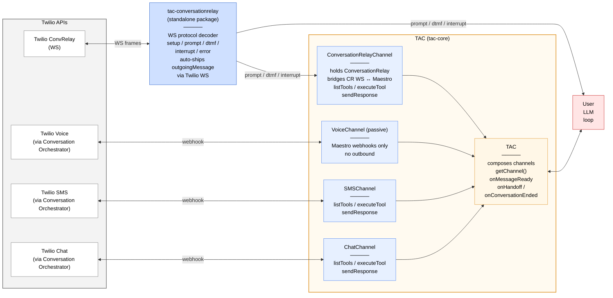

# Twilio Agent Connect (TAC)

Twilio Agent Connect (TAC) is a powerful TypeScript library designed to simplify the development of intelligent,
context-aware applications using Twilio's communication technologies. TAC provides seamless integration with Twilio's
Memory and Conversation services, enabling you to build LLM-powered agents with persistent memory and conversation context.

> [!NOTE]
> Looking for the Python version? Check out [TAC SDK Python](https://github.com/twilio-innovation/twilio-agent-connect-python).

Explore the [getting_started](getting_started) directory to see the SDK in action.

## Key Features

- **Multi-Channel Support**: SMS, Voice (passive Maestro), ConversationRelay (active voice), and Chat channels
- **Unified Architecture**: Uses Conversation Orchestrator Conversations Service for all channels with ConversationRelay for voice
- **Memory Management**: Automatic integration with Twilio Memory for persistent user context
- **Conversation Lifecycle**: Automatic tracking of conversation sessions and state
- **Type-Safe**: Full TypeScript support with strict type checking
- **Callback-Based**: Unified `onMessageReady` callback for LLM integration with `messageType` discriminator
- **Production Ready**: Comprehensive test coverage and error handling

## Get Started

To get started, set up your Node.js environment (Node.js 22.13.0 or newer required).

> [!IMPORTANT]
> TAC packages are not yet published to npm. We recommend building your agent directly in this repository.

```bash
git clone https://github.com/twilio-innovation/twilio-agent-connect-typescript.git
cd twilio-agent-connect-typescript

npm install
npm run build
```

## Pick your use case

Every production setup starts from one of three patterns. Each working example has a full README with env vars, ngrok setup, Twilio console wiring, and a complete source file. Go to the example README that matches your use case:

| Use case | Example | Packages | Runs |
|---|---|---|---|
| **Voice only** — no Conversation Orchestrator, own your LLM loop | [getting_started/examples/crelay/](getting_started/examples/crelay/) | `@twilio/tac-conversationrelay` | `ConversationRelayServer` on one port |
| **Voice + SMS + Memory** — cross-channel identity, persistent profiles | [getting_started/examples/conversation/](getting_started/examples/conversation/) | `twilio-agent-connect` (tac-core + CR) | Two servers on two ports |
| **Web chat, no voice** | [getting_started/examples/chat/](getting_started/examples/chat/) | `twilio-agent-connect` (tac-core only) | `TACServer` on one port |

Pick the example that matches, copy its `.env.example`, follow its README. This document is for the architecture.

## Architecture

TAC uses **Conversation Orchestrator Conversations Service** for unified conversation orchestration across all channels:

- **Voice**: Integrates ConversationRelay WebSocket with Conversation Orchestrator for real-time bidirectional streaming
- **SMS**: Conversation Orchestrator webhook ingestion and response delivery
- **Chat**: Conversation Orchestrator webhook ingestion and response delivery

All channels require `TWILIO_CONVERSATION_CONFIGURATION_ID` to be configured in your environment.

Voice comes in two flavours as two distinct channel classes:

- **`ConversationRelayChannel`** — active voice. Holds a `ConversationRelay` instance and bridges the CR WebSocket (setup / prompt / interrupt / dtmf) to Conversation Orchestrator. Outbound text / DTMF / play / end go over the CR WebSocket. `ChannelMessage.channel === 'crelay'`.
- **`VoiceChannel`** — passive voice. Consumes Conversation Orchestrator webhooks only — no WebSocket, no outbound. Useful for BYO-CR setups, inbound-only transcript analysis, or anywhere this service doesn't own the CR WebSocket. `ChannelMessage.channel === 'voice'`. Calling `sendResponse` throws.

### Two servers, two ports

The voice stack (`/twiml`, `/ws`, `/conversation-relay-callback`) runs on `ConversationRelayServer` from `@twilio/tac-conversationrelay`. The Conversation Orchestrator fan-out (`/webhook`, optional `/cintel`) runs on `TACServer` from `@twilio/tac-server`. Typical deployment runs both on separate ports:

| Server | Port | Twilio config |
|---|---|---|
| `ConversationRelayServer` | `:8001` | Point voice numbers at `https://<host>:8001/twiml` |
| `TACServer` | `:8000` | Point Conversations Service webhooks at `https://<host>:8000/webhook` |

The split is enforced by the package layout: `@twilio/tac-conversationrelay` has **zero** dependency on `@twilio/tac-core`. Run CR standalone (drive your own LLM via CR events), run Conversation Orchestrator standalone (SMS/Chat/passive-voice only), or wire them together via two optional callbacks on `ConversationRelayServer` — see [`packages/conversationrelay/README.md`](packages/conversationrelay/README.md).

#### Exposing two ports for local dev

ngrok forwards one port per tunnel, so a voice + Maestro setup needs two tunnels and two separate Twilio console entries:

```bash
ngrok http 8000    # → TACServer       (Conversation Orchestrator webhooks)
ngrok http 8001    # → ConversationRelayServer (voice)
```

| What you're wiring | Twilio console page | URL |
|---|---|---|
| Phone-number Voice webhook | Phone Numbers → Active numbers → your number → Voice Configuration | `https://<voice-ngrok>/twiml` (POST) |
| Conversation Configuration webhook | Conversation Orchestrator → Conversation Configurations → Overview → Edit | `https://<maestro-ngrok>/webhook` (POST) |

`/ws` and `/conversation-relay-callback` aren't configured separately in the Twilio console — `ConversationRelayServer` builds those URLs from `publicDomain` (see below) and splices them into the `/twiml` response. Inbound SMS routes through Maestro, not the Messaging webhook on the phone number page.

**Dev-loop tip.** With ephemeral tunnels you re-paste both URLs into the console on every ngrok restart. Reserved ngrok subdomains (`ngrok http --url <subdomain>.ngrok.dev <port>`) let you paste them once. See [`getting_started/examples/conversation/README.md`](getting_started/examples/conversation/README.md) for the end-to-end walkthrough.

#### Public domains are required

Both servers require an explicit `publicDomain` — the bare host Twilio reaches them at. This is used for webhook signature validation and, for CR, to build the `wss://` URL spliced into the TwiML. Two env vars because the servers are independent and commonly sit behind different tunnels / hostnames:

| Env var | Consumed by |
|---|---|
| `TAC_PUBLIC_DOMAIN` | `new TACServer(tac, { publicDomain: ... })` |
| `CR_PUBLIC_DOMAIN`  | `new ConversationRelayServer(cr, { publicDomain: ... })` |

Why explicit: load balancers (AWS ALB, GCP LB) and default reverse-proxy configs (NGINX, Apache) rewrite the `Host` header to internal backend addresses, so reconstructing the URL from request headers is unreliable. Configuration-based URL construction is deterministic and resistant to header-spoofing.

Accepts either a bare host or a full `https://...` URL (values are normalised).



> **LLM SDK (OpenAI, Anthropic, Google, …) lives in USER code, never in TAC.** Neither `@twilio/tac-core` nor `@twilio/tac-conversationrelay` imports any LLM SDK — vendor format is opt-in via `ConversationRelayTool.toOpenAIFormat()` / `toAnthropicFormat()` at the call site.
>
> **Uniform tool flow.** `channel.listTools()` + `channel.executeTool(conversationId, name, args)` — same surface on `ConversationRelayChannel`, SMS, and chat. `msg.channel` discriminator (`'crelay' | 'sms' | 'chat' | 'voice'`) routes to the right channel; one LLM loop serves all of them. On `ConversationRelayChannel`, `outgoingMessage` auto-shipping happens inside `executeTool`, invisible at the call site.

## Setup shapes

The minimum code for each shape. Full examples are in `getting_started/examples/` — these snippets show only what's distinctive about each shape.

### TAC without CR (chat or SMS only)

`ConversationRelay` is not constructed. Only `TACServer` runs; no voice routes. Works for web chat, SMS, and passive-voice (inbound-analysis) deployments.

```typescript
import { TAC, TACConfig, ChatChannel, TACServer } from 'twilio-agent-connect';

const tac = await TAC.create({ config: TACConfig.fromEnv() });
const chatChannel = new ChatChannel(tac.getChannelDeps(), {
  conversationsV1ServiceSid: tac.conversationsV1ServiceSid,
});
tac.registerChannel(chatChannel);

tac.onMessageReady(async msg => {
  if (msg.messageType !== 'user') return;
  const reply = await yourLLM(msg.message);
  return reply; // auto-sent via the originating channel's sendResponse
});

await new TACServer(tac, {
  port: 8000,
  publicDomain: process.env.TAC_PUBLIC_DOMAIN!, // required
}).start();
```

Point Conversations Service webhooks at `https://<host>:8000/webhook`. See [getting_started/examples/chat/](getting_started/examples/chat/) for the complete browser + server setup.

### TAC with CR (voice + multi-channel)

`ConversationRelay` is constructed once and handed to `ConversationRelayChannel` (the CR ↔ Maestro bridge) and `ConversationRelayServer` (the WS frame feeder). Two Fastify servers start in one process.

```typescript
import {
  TAC, TACConfig, ConversationRelayChannel, SMSChannel,
  TACServer, ConversationRelay, ConversationRelayServer,
} from 'twilio-agent-connect';

const tac = await TAC.create({ config: TACConfig.fromEnv() });
const cr = new ConversationRelay(tac.logger.child({ component: 'crelay' }));
const crChannel = new ConversationRelayChannel(tac.getChannelDeps(), { conversationRelay: cr });
tac.registerChannel(crChannel);
tac.registerChannel(new SMSChannel(tac.getChannelDeps()));

tac.onMessageReady(async msg => { /* your LLM loop — msg.channel === 'crelay' for active voice */ });

const tacServer = new TACServer(tac, {
  port: 8000,
  publicDomain: process.env.TAC_PUBLIC_DOMAIN!, // required
});
const crServer = new ConversationRelayServer(cr, {
  authToken: tac.getConfig().authToken,
  publicDomain: process.env.CR_PUBLIC_DOMAIN!, // required
  port: 8001,
  onIncomingCall: (input) => crChannel.createConversationForCall(input),
  onConversationRelayCallback: (payload) =>
    crChannel.handleConversationRelayCallback(payload),
});

await Promise.all([tacServer.start(), crServer.start()]);
```

The two callbacks thread `ConversationRelayChannel` through `ConversationRelayServer` without CR importing from tac-core — `createConversationForCall` returns four Conversation Orchestrator IDs as a plain record, which CR splices into `<ConversationRelay>` customParameters. See [getting_started/examples/conversation/](getting_started/examples/conversation/) for the complete multi-channel version with OpenAI, memory context, and voice interruption handling.

### Customizing the TACServer Fastify instance

`TACServer` exposes its underlying Fastify instance as `server.fastify` so you can add hooks, plugins, or extra routes (e.g. a health check for your load balancer):

```typescript
import Fastify from 'fastify';
import cors from '@fastify/cors';
import { TACServer } from 'twilio-agent-connect';

const app = Fastify({ logger: true, trustProxy: true });
await app.register(cors, { origin: '*' });

const server = new TACServer(tac, {
  fastifyInstance: app,
  publicDomain: process.env.TAC_PUBLIC_DOMAIN!, // required
});
server.fastify.get('/health', async () => ({ status: 'ok' }));
await server.start();
```

## How It Works

TAC simplifies building AI agents by handling the integration between Twilio's communication channels and your LLM:

1. **Webhook / connection received**: Twilio sends a webhook (SMS / Chat) or WebSocket connection (Voice) to your server.
2. **Channel processing**: The channel validates and processes the incoming event.
3. **Memory retrieval**: TAC optionally retrieves user memories and profile from Memory.
4. **Callback invoked**: Your `onMessageReady` callback receives the user message, context, and optional memory response.
5. **LLM integration**: Your code calls the LLM and sends the response back through the appropriate channel.

For detailed architecture and API reference, see [CLAUDE.md](CLAUDE.md).

## Learn More

**Examples:**
- [Getting Started Guide](getting_started/) — examples and comprehensive documentation
- [Conversation Example](getting_started/examples/conversation/) — multi-channel Voice + SMS with OpenAI, memory, and voice interruption handling
- [CRelay Example](getting_started/examples/crelay/) — voice-only with ConversationRelay, standalone
- [Chat Example](getting_started/examples/chat/) — web chat with Twilio Conversations JS SDK

**Documentation:**
- [CLAUDE.md](CLAUDE.md) — architecture, development guide, and API reference
- [Getting Started Guide](getting_started/README.md) — setup instructions, environment variables, and troubleshooting
- [packages/conversationrelay/README.md](packages/conversationrelay/README.md) — CR package specifics, voice-turn patterns (silence detection, listen mode)

---

# TAC Development / Contribution

TAC uses npm workspaces for package management. Ensure you have Node.js and npm installed:

```bash
node --version  # Should be 22.13.0 or newer
npm --version   # Should be 9 or newer
```

### Setup Development Environment

```bash
git clone https://github.com/twilio-innovation/twilio-agent-connect-typescript.git
cd twilio-agent-connect-typescript

npm install
npm run build
```

### Running Tests and Checks

```bash
npm run format        # prettier --write
npm run lint          # eslint check
npm run typecheck     # tsc --noEmit
npm test              # vitest
npm run test:watch    # dev loop

# Matches Buildkite CI exactly:
npm run build && npm run lint && npm run typecheck && npm test
```
