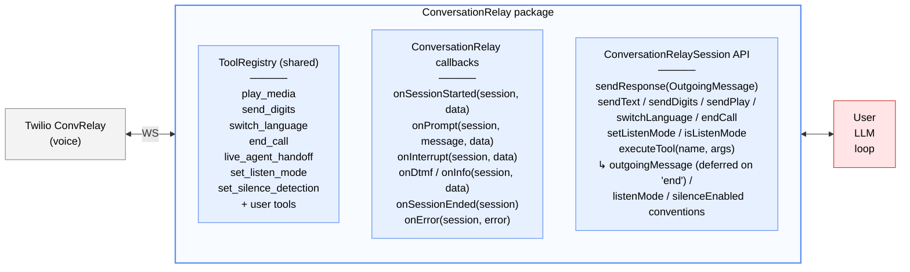

# @twilio/tac-conversationrelay

Pure ConversationRelay protocol utility for voice-only Twilio applications. Can be used standalone or as part of the TAC framework.

## Features

- WebSocket protocol handling for Twilio ConversationRelay
- One `ConversationRelaySession` per WebSocket — session-scoped public API (no CallSid threading)
- Event routing via callbacks; every callback receives the `ConversationRelaySession`
- TwiML generation for `<ConversationRelay>` noun
- `ToolRegistry` — protocol tools (text / DTMF / media / language / end) plus state tools (listen-mode toggle, silence-detection toggle, live-agent handoff), all LLM-discoverable
- Built-in per-session silence handling — opt-in via constructor config
- Built-in per-session listen-mode — toggleable via method or LLM tool, gates outgoing speech
- Terminal-message deferral — `end` frames from tools wait for the next `sendText(..., last: true)` so farewell tokens reach TTS before hangup
- Standalone server option (no Conversation Orchestrator required)

## Package shape

Three classes cover everything:

- **`ConversationRelay`** — the manager. Owns the per-CallSid session directory, the shared `ToolRegistry`, the silence template, the WebSocket `on('message' | 'close' | 'error')` handlers, callback fan-out, and TwiML generation. One per process (usually).
- **`ConversationRelaySession`** — one per WebSocket. Owns the `ws`, session identity (`callSid`, `from`, `to`, `startedAt`, `customParameters`), listen-mode + suppressed-count, the per-session `SilenceHandler`, and the deferred-terminal slot. All outbound methods (`sendText`, `sendPlay`, `sendDigits`, `switchLanguage`, `endCall`, `setListenMode`, `executeTool`, …) are on the session — they act on `this`, not a CallSid argument.
- **`ToolRegistry`** — named lookup for `ConversationRelayTool` instances. Passed to `ConversationRelay` at construction (or auto-built from `CONVERSATION_RELAY_TOOLS`). `register` / `unregister` / `list` / `get` / `has`. Shared across every in-flight session — register once, available everywhere.

> `CRTool` was renamed to `ConversationRelayTool`. No alias — update imports.

## Architecture



> **LLM SDK (OpenAI, Anthropic, Google, …) lives in USER code, never in CR.**
> Tool format conversion via `ConversationRelayTool.toOpenAIFormat()` / `toAnthropicFormat()` at the call site.

## When to use this package

- **Voice-only app, no Conversation Orchestrator / no multi-channel** → use this package standalone. Session identity is the `CallSid`; you own LLM, history, and memory.
- **Voice + SMS / Chat, cross-channel identity, Twilio Memory** → use [`twilio-agent-connect`](../../README.md) (tac-core). This package is still used under the hood — tac-core's `ConversationRelayChannel` holds a `ConversationRelay` instance and integrates it with Conversation Orchestrator Conversations.

## Installation

```bash
npm install @twilio/tac-conversationrelay
```

## Setup

Both modes start the same way: construct `ConversationRelay`, register callbacks, pass the instance to `ConversationRelayServer`, start the server, point a Twilio voice number at `https://<host>:<port>/twiml`. What changes is whether you wire the server's optional callbacks to Conversation Orchestrator.

### Standalone mode (no Conversation Orchestrator)

Point your Twilio voice number at `/twiml` and drive your own LLM via `cr.onPrompt` / `session.sendText`. No Conversation Orchestrator conversation is created; session identity is the `CallSid`.

Working example: **[`getting_started/examples/crelay/`](../../getting_started/examples/crelay/)** — OpenAI-backed voice agent, with interruption handling, tool dispatch, silence handling, and env setup. Read its README to go end-to-end.

The minimum server wiring:

```typescript
import {
  ConversationRelay,
  ConversationRelayServer,
  createLogger,
} from '@twilio/tac-conversationrelay';

const logger = createLogger({ name: 'my-voice-agent' });

// Optional: opt into built-in silence handling. After 30s of silence CR
// fires "Are you still there?"; after 30s more it hangs up.
const cr = new ConversationRelay(logger, {
  silence: { thresholdSeconds: 30 },
});

cr.onPrompt(async (session, message) => {
  const reply = await yourLLM.chat(message);
  session.sendText(reply);
});

await new ConversationRelayServer(cr, {
  authToken: process.env.TWILIO_AUTH_TOKEN!,
  publicDomain: process.env.CR_PUBLIC_DOMAIN!, // required
  port: 8001,
}).start();
```

### Integrated mode (with tac-core / Conversation Orchestrator)

`ConversationRelayServer` exposes two optional callbacks — `onIncomingCall` and `onConversationRelayCallback` — that let you splice Conversation Orchestrator into the TwiML / callback paths without this package importing from tac-core. Wire them to `ConversationRelayChannel` methods that return plain data records:

- `onIncomingCall` is called on `POST /twiml`. Return a `Record<string, string>` of customParameters; CR splices them into the `<ConversationRelay>` TwiML element. `ConversationRelayChannel.createConversationForCall` returns the four Conversation Orchestrator IDs (`conversation_id`, `profile_id`, `customer_participant_id`, `ai_agent_participant_id`), which arrive on the CR `setup` frame at WebSocket connect.
- `onConversationRelayCallback` is called when Twilio POSTs the URL declared as `<ConversationRelay action="…">` — at call-end (`CallStatus: 'completed'`) and on handoff requests. Return `{ status, content, contentType }`; `ConversationRelayChannel.handleConversationRelayCallback` closes the Conversation Orchestrator conversation and returns handoff TwiML when applicable.

Omit both callbacks → standalone behaviour. Pass both → integrated. The package itself has **zero** dependency on `@twilio/tac-core`.

Working example: **[`getting_started/examples/conversation/`](../../getting_started/examples/conversation/)** — voice + SMS with Conversation Orchestrator, memory, and profile. Two Fastify servers in one process (TACServer :8000 for Conversation Orchestrator webhooks, ConversationRelayServer :8001 for voice).

## API reference

### `new ConversationRelay(logger?, config?)`

```typescript
new ConversationRelay(
  logger?: Logger,
  config?: {
    silence?: { thresholdSeconds?: number; additionalPrompts?: [string] | [string, string] };
    tools?: ToolRegistry;
  }
);
```

- `logger` — Pino-style logger. Defaults to an internal logger if omitted.
- `config.silence` — opt-in per-session silence handling. Omit entirely → no silence monitoring. Pass `{}` → defaults (`thresholdSeconds: 20`, one reminder "Are you still there?" then terminate). `additionalPrompts` appends extra reminders before termination.
- `config.tools` — custom `ToolRegistry`. Omit for a default registry pre-populated with the seven `CONVERSATION_RELAY_TOOLS` built-ins.

### Callbacks (on `ConversationRelay`)

Every callback receives the active `ConversationRelaySession` as the first argument. The CallSid is reachable as `session.callSid`.

- `onSessionStarted((session, data) => …)` — call connects (setup message received). `data: SetupMessage`.
- `onPrompt((session, message, data) => …)` — user transcript arrived. `data: PromptMessage`.
- `onInterrupt((session, data) => …)` — user interrupted agent speech.
- `onDtmf((session, data) => …)` — DTMF input.
- `onInfo((session, data) => …)` — INFO / diagnostic messages.
- `onSessionEnded((session) => …)` — call ended (WebSocket closed).
- `onError((session, error) => …)` — error reported.

### Directory access (on `ConversationRelay`)

- `getSession(callSid)` — fetch the active `ConversationRelaySession` for a CallSid, or `undefined`.
- `hasSession(callSid)` — whether an active session exists for that CallSid.
- `getToolRegistry()` — the shared `ToolRegistry`.
- `shutdown()` — close every session's ws and clear the registry.

### Outgoing messages (on `ConversationRelaySession`)

All outgoing methods live on the session and act on `this` — no CallSid threading. All frames converge on one public chokepoint, `session.sendResponse(OutgoingMessage)`. The typed wrappers build the `OutgoingMessage` for you so callers don't touch protocol shape:

- `session.sendText(token, last?)` — send a text token for TTS. `last` defaults to `true`. When `last: true` also flushes any deferred terminal frame stashed by a prior `executeTool` (see below).
- `session.sendPlay(source, options?)` — play media from URL. `options = { loop?, interruptible?, preemptible? }`.
- `session.sendDigits(digits)` — send DTMF digits (0-9, `w` = 500ms pause, `*`, `#`).
- `session.switchLanguage({ ttsLanguage?, transcriptionLanguage? })` — change TTS or transcription language mid-call.
- `session.endCall(handoffData?)` — end the call immediately. `handoffData` is an object; CR `JSON.stringify`s it for you. Bypasses terminal deferral — direct callers are asking for immediate hangup.
- `session.sendResponse(message: OutgoingMessage)` — escape hatch for advanced users / future protocol frames.

**Listen-mode gating happens inside `sendResponse`.** When a session has listen-mode on, outgoing `text` / `play` / `language` frames are suppressed (session counter increments, no wire write). `sendDigits` and `end` are never gated — DTMF navigation and termination must always work.

### Terminal-message deferral

When a tool returns `{ outgoingMessage: { type: 'end', ... } }` (e.g. `end_call`, `live_agent_handoff`), the session **stashes** the terminal frame instead of shipping it. The next `sendText(..., last: true)` flushes it *after* the last text token. This gives the LLM's streaming farewell ("Okay, transferring you now — one moment!") a chance to reach TTS before Twilio hangs up; without deferral, the `end` frame races the final text tokens and you get mid-sentence cutoffs.

If you invoke `session.endCall(...)` directly (not via a tool), deferral is bypassed and the call hangs up immediately.

### Listen mode (on `ConversationRelaySession`)

- `session.setListenMode(enabled)` — toggle listen-mode for this session. On enable, any active `SilenceHandler` stops. On disable, it re-arms from zero.
- `session.isListenMode()` — read the current flag.
- `session.getSuppressedMessageCount()` — diagnostic counter of messages suppressed by listen-mode on this session.

### Tool dispatch

- `session.executeTool(name, args)` — run a tool's implementation and apply any side-effects encoded in its result. Returns the raw result for the caller to feed back into the LLM loop.

### `ToolRegistry`

Named-lookup container for `ConversationRelayTool` instances. Shared by every in-flight session — registering a tool makes it available to every active call immediately.

- `registry.register(tool)` — register a tool (last-write-wins on name collisions).
- `registry.unregister(name)` — remove by name.
- `registry.get(name)` / `registry.has(name)`.
- `registry.list()` — all registered tools in registration order. Feed into the LLM via `tool.toOpenAIFormat()` / `toAnthropicFormat()`.

The default registry (when `config.tools` is omitted) is `new ToolRegistry(CONVERSATION_RELAY_TOOLS)`. To customise — e.g. drop a built-in:

```typescript
import { ConversationRelay, ToolRegistry, CONVERSATION_RELAY_TOOLS } from '@twilio/tac-conversationrelay';

const registry = new ToolRegistry(
  CONVERSATION_RELAY_TOOLS.filter(t => t.name !== 'end_call'),
);
registry.register(myCustomTool);

const cr = new ConversationRelay(logger, { tools: registry });
```

### `executeTool` — result conventions

The tool body returns a plain object. The session inspects the result and applies up to three side-effects:

| Result field | Side-effect | Example tool |
|---|---|---|
| `outgoingMessage: OutgoingMessage` | Validated and shipped via `sendResponse` — except `type: 'end'`, which is **deferred** until the next `sendText(..., last: true)` | `play_media`, `send_digits`, `switch_language`, `end_call`, `live_agent_handoff` |
| `listenMode: boolean` | `session.setListenMode(value)` | `set_listen_mode` |
| `silenceEnabled: boolean` | `session.silenceHandler.setEnabled(value)` (+ `reset()` on enable); no-op if no handler | `set_silence_detection` |

Tool bodies stay pure — they never touch the session or CallSid directly. The result is also returned to the caller so it can be fed back into the LLM loop.

### Built-in tools

The seven tools in `CONVERSATION_RELAY_TOOLS` are auto-registered on every default `ConversationRelay`; remove any via `cr.getToolRegistry().unregister(name)`.

**Protocol tools** (emit an `outgoingMessage`):
- `play_media` — play audio URL
- `send_digits` — send DTMF
- `switch_language` — change TTS / transcription language
- `end_call` — terminate the call, optional handoff data
- `live_agent_handoff` — preset over `end_call` for human escalation; emits `handoffData: { reasonCode: 'live-agent-handoff', reason, ...extra }`

**State tools** (mutate CR session state):
- `set_listen_mode` — toggle listen-mode for the current call
- `set_silence_detection` — toggle silence monitoring for the current call (no-op if CR wasn't constructed with silence config)

### Server / lifecycle

- `generateTwiML(config, parameters, options)` — generate `<ConversationRelay>` TwiML
- `handleConnection(ws)` — accept a WebSocket connection
- `shutdown()` — close all connections

### ConversationRelayServer

Standalone Fastify server wrapping a `ConversationRelay` instance. Serves `/twiml`, `/ws`, and `/conversation-relay-callback` (plus a silent `/webhook` sink for Conversation Orchestrator misconfigurations).

**Constructor:**
```typescript
new ConversationRelayServer(conversationRelay: ConversationRelay, config: ConversationRelayServerConfig)
```

**Config options:**
- `host` — default `'0.0.0.0'`
- `port` — default `8001`
- `webhookPaths` — override any of `twiml`, `ws`, `callback`, `webhook`
- `conversationRelayConfig` — TwiML attributes (welcomeGreeting, ttsProvider, voice, transcriptionProvider, etc.)
- `development` — enable pino-pretty logging
- `authToken` — **required**. Twilio auth token; signature validation is always on
- `publicDomain` — **required**. Public URL Twilio reaches this server at. Accepts a full `https://...` URL (e.g. `https://cr-<you>.ngrok.dev`) or a bare host (e.g. `cr-<you>.ngrok.dev`) — values are normalised. Used for webhook signature validation and to build the `wss://` URL spliced into the TwiML response. Load balancers and reverse proxies rewrite the `Host` header to internal backend addresses, so an explicit value is required.
- `onIncomingCall?` — optional. `(input) => Promise<CustomParameters>`. Splices returned record into `<ConversationRelay>` as `<Parameter>` elements. Omit for standalone (CR emits `{ conversation_id: callSid }`)
- `onConversationRelayCallback?` — optional. `(payload) => Promise<{ status, content, contentType }>`. Called when Twilio POSTs the TwiML `action` URL (call-end and handoff). Omit for standalone (200 OK no-op)

## Voice-turn patterns (built in)

Two patterns come up in nearly every production voice agent. Both are first-class features of this package — you opt in via config and the LLM toggles them via built-in tools.

### Silence handling

CR only emits `{type: 'prompt'}` when STT has a transcript. If the caller goes quiet, the WebSocket stays open and nothing tells you. Pass a `silence` config at construction and CR handles the rest:

```typescript
const cr = new ConversationRelay(logger, {
  silence: {
    thresholdSeconds: 30,              // default 20
    additionalPrompts: ['Still there?'], // up to 2 extra prompts before terminate
  },
});
```

With `silence: {}` (defaults): after 20s, CR sends "Are you still there?"; after 20s more, it hangs up with `handoffData: { reasonCode: 'unresponsive', reason: 'The caller was not speaking' }`. With `additionalPrompts` added, each extra prompt is spoken in order before termination.

CR auto-constructs a `SilenceHandler` per session, resets it on prompt/interrupt/dtmf, and stops it on WS close. **Zero wiring in your code.** The `set_silence_detection` built-in tool lets the LLM toggle it mid-call.

### Listen mode (response suppression)

Sometimes the agent should listen but not speak — typical use is outbound IVR navigation, where the LLM sends DTMF to traverse menus and listens for a human, then starts speaking once it detects one.

```typescript
session.setListenMode(true);  // text/play/language suppressed; sendDigits still works
// ... LLM sends DTMF, waits ...
session.setListenMode(false); // re-enabled; agent can speak
```

Or let the LLM control it directly — the `set_listen_mode` built-in tool is in `cr.getToolRegistry().list()` by default. Pass it into your LLM as its toolset and it can toggle listen-mode the same way it calls `send_digits`:

```typescript
// LLM calls: set_listen_mode({ enabled: true })
// → CR flips the flag, silence detection pauses, subsequent sendText calls drop.
```

When listen-mode flips off, any configured `SilenceHandler` re-arms from zero.

## Authoring custom tools

```typescript
import { defineTool } from '@twilio/tac-conversationrelay';

const lookupOrder = defineTool(
  'lookup_order',
  'Fetch order status by order ID',
  {
    type: 'object',
    properties: { orderId: { type: 'string' } },
    required: ['orderId'],
  },
  async ({ orderId }: { orderId: string }) => {
    const order = await orderService.get(orderId);
    return { success: true, status: order.status };
  }
);

cr.getToolRegistry().register(lookupOrder);
```

User tools without a convention field (`outgoingMessage`, `listenMode`, `silenceEnabled`) return their result for the LLM loop to consume. Built-in tools use the same conventions — your call site looks the same for all of them.

## License

MIT
