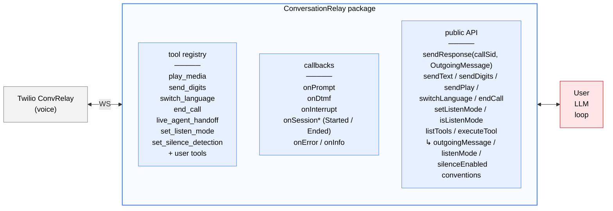

# @twilio/tac-conversationrelay

Pure ConversationRelay protocol utility for voice-only Twilio applications. Can be used standalone or as part of the TAC framework.

## Features

- WebSocket protocol handling for Twilio ConversationRelay
- Session lifecycle management (per CallSid)
- Event routing via callbacks
- TwiML generation for `<ConversationRelay>` noun
- Built-in tool registry — protocol tools (text / DTMF / media / language / end) plus state tools (listen-mode toggle, silence-detection toggle, live-agent handoff), all LLM-discoverable
- Built-in per-session silence handling — opt-in via constructor config
- Built-in per-session listen-mode — toggleable via method or LLM tool, gates outgoing speech
- Standalone server option (no Conversation Orchestrator required)

## Architecture



> **LLM SDK (OpenAI, Anthropic, Google, …) lives in USER code, never in CR.**
> Tool format conversion via `CRTool.toOpenAIFormat()` / `toAnthropicFormat()` at the call site.

## When to use this package

- **Voice-only app, no Conversation Orchestrator / no multi-channel** → use this package standalone. Session identity is the `CallSid`; you own LLM, history, and memory.
- **Voice + SMS / Chat, cross-channel identity, Twilio Memory** → use [`twilio-agent-connect`](../../README.md) (tac-core). This package is still used under the hood — tac-core's `VoiceChannel` embeds a `ConversationRelay` instance and integrates it with Conversation Orchestrator Conversations.

## Installation

```bash
npm install @twilio/tac-conversationrelay
```

## Setup

Both modes start the same way: construct `ConversationRelay`, register callbacks, pass the instance to `ConversationRelayServer`, start the server, point a Twilio voice number at `https://<host>:<port>/twiml`. What changes is whether you wire the server's optional callbacks to Conversation Orchestrator.

### Standalone mode (no Conversation Orchestrator)

Point your Twilio voice number at `/twiml` and drive your own LLM via `cr.onPrompt` / `cr.sendText`. No Conversation Orchestrator conversation is created; session identity is the `CallSid`.

Working example: **[`getting_started/examples/crelay/`](../../getting_started/examples/crelay/)** — OpenAI-backed voice agent, with interruption handling, tool dispatch, silence handling, and env setup. Read its README to go end-to-end.

The minimum server wiring:

```typescript
import {
  ConversationRelay,
  ConversationRelayServer,
  createLogger,
} from '@twilio/tac-conversationrelay';

const logger = createLogger({ name: 'my-voice-agent' });

// Optional: opt into built-in silence handling. After 30s of silence CR
// fires "Are you still there?"; after 30s more it hangs up.
const cr = new ConversationRelay(logger, {
  silence: { thresholdSeconds: 30 },
});

cr.onPrompt(async (callSid, message) => {
  const reply = await yourLLM.chat(message);
  cr.sendText(callSid, reply);
});

await new ConversationRelayServer(cr, {
  authToken: process.env.TWILIO_AUTH_TOKEN!,
  port: 8001,
}).start();
```

### Integrated mode (with tac-core / Conversation Orchestrator)

`ConversationRelayServer` exposes two optional callbacks — `onIncomingCall` and `onConversationRelayCallback` — that let you splice Conversation Orchestrator into the TwiML / callback paths without this package importing from tac-core. Wire them to `VoiceChannel` methods that return plain data records:

- `onIncomingCall` is called on `POST /twiml`. Return a `Record<string, string>` of customParameters; CR splices them into the `<ConversationRelay>` TwiML element. `VoiceChannel.createConversationForCall` returns the four Conversation Orchestrator IDs (`conversation_id`, `profile_id`, `customer_participant_id`, `ai_agent_participant_id`), which arrive on the CR `setup` frame at WebSocket connect.
- `onConversationRelayCallback` is called when Twilio POSTs the URL declared as `<ConversationRelay action="…">` — at call-end (`CallStatus: 'completed'`) and on handoff requests. Return `{ status, content, contentType }`; `VoiceChannel.handleConversationRelayCallback` closes the Conversation Orchestrator conversation and returns handoff TwiML when applicable.

Omit both callbacks → standalone behaviour. Pass both → integrated. The package itself has **zero** dependency on `@twilio/tac-core`.

Working example: **[`getting_started/examples/conversation/`](../../getting_started/examples/conversation/)** — voice + SMS with Conversation Orchestrator, memory, and profile. Two Fastify servers in one process (TACServer :8000 for Conversation Orchestrator webhooks, ConversationRelayServer :8001 for voice).

## API reference

### `new ConversationRelay(logger?, config?)`

```typescript
new ConversationRelay(
  logger?: Logger,
  config?: { silence?: { thresholdSeconds?: number; additionalPrompts?: [string] | [string, string] } }
);
```

- `logger` — Pino-style logger. Defaults to an internal logger if omitted.
- `config.silence` — opt-in per-session silence handling. Omit entirely → no silence monitoring. Pass `{}` → defaults (`thresholdSeconds: 20`, one reminder "Are you still there?" then terminate). `additionalPrompts` prepends extra reminders before termination.

### Callbacks

- `onSessionStarted(callback)` — call connects (setup message received)
- `onPrompt(callback)` — user transcript arrived (CR `prompt` message)
- `onInterrupt(callback)` — user interrupted agent speech
- `onDtmf(callback)` — DTMF input
- `onInfo(callback)` — INFO / diagnostic messages
- `onSessionEnded(callback)` — call ended (WebSocket closed)
- `onError(callback)` — error reported

### Outgoing messages

All outgoing frames converge on one public chokepoint, `sendResponse(callSid, OutgoingMessage)`. The typed wrappers build the `OutgoingMessage` for you so callers don't touch protocol shape:

- `sendText(callSid, token, last?)` — send a text token for TTS. `last` defaults to `true`.
- `sendPlay(callSid, source, options?)` — play media from URL. `options = { loop?, interruptible?, preemptible? }`.
- `sendDigits(callSid, digits)` — send DTMF digits (0-9, `w` = 500ms pause, `*`, `#`).
- `switchLanguage(callSid, { ttsLanguage?, transcriptionLanguage? })` — change TTS or transcription language mid-call.
- `endCall(callSid, handoffData?)` — end the call. `handoffData` is an object; CR `JSON.stringify`s it for you.
- `sendResponse(callSid, message: OutgoingMessage)` — escape hatch for advanced users / future protocol frames.

**Listen-mode gating happens inside `sendResponse`.** When a session has listen-mode on, outgoing `text` / `play` / `language` frames are suppressed (session counter increments, no wire write). `sendDigits` and `end` are never gated — DTMF navigation and termination must always work.

### Listen mode

- `setListenMode(callSid, enabled)` — toggle listen-mode for a session. On enable, any active `SilenceHandler` stops. On disable, it re-arms from zero.
- `isListenMode(callSid)` — read the current flag. Returns `false` if no session exists.
- `getSuppressedMessageCount(callSid)` — diagnostic counter of messages suppressed by listen-mode on this session.

### Tool registry

- `listTools()` — all registered tools (built-ins + user-registered)
- `registerTool(tool)` — register an additional `CRTool`
- `unregisterTool(name)` — remove a tool
- `executeTool(callSid, name, args)` — run a tool's implementation and apply any side-effects encoded in its result

### `executeTool` — result conventions

The tool body returns a plain object. CR inspects the result and applies up to three side-effects:

| Result field | Side-effect | Example tool |
|---|---|---|
| `outgoingMessage: OutgoingMessage` | Validated and shipped via `sendResponse` | `play_media`, `send_digits`, `switch_language`, `end_call`, `live_agent_handoff` |
| `listenMode: boolean` | `setListenMode(callSid, value)` | `set_listen_mode` |
| `silenceEnabled: boolean` | `session.silenceHandler.setEnabled(value)` (+ `reset()` on enable); no-op if no handler | `set_silence_detection` |

Tool bodies stay pure — they never touch CR state or CallSid directly. The result is also returned to the caller so it can be fed back into the LLM loop.

### Built-in tools

Seven are auto-registered on every `ConversationRelay` instance; remove any via `unregisterTool(name)`.

**Protocol tools** (emit an `outgoingMessage`):
- `play_media` — play audio URL
- `send_digits` — send DTMF
- `switch_language` — change TTS / transcription language
- `end_call` — terminate the call, optional handoff data
- `live_agent_handoff` — preset over `end_call` for human escalation; emits `handoffData: { reasonCode: 'live-agent-handoff', reason, ...extra }`

**State tools** (mutate CR session state):
- `set_listen_mode` — toggle listen-mode for the current call
- `set_silence_detection` — toggle silence monitoring for the current call (no-op if CR wasn't constructed with silence config)

### Server / lifecycle

- `generateTwiML(config, parameters, options)` — generate `<ConversationRelay>` TwiML
- `handleConnection(ws)` — accept a WebSocket connection
- `shutdown()` — close all connections

### ConversationRelayServer

Standalone Fastify server wrapping a `ConversationRelay` instance. Serves `/twiml`, `/ws`, and `/conversation-relay-callback` (plus a silent `/webhook` sink for Conversation Orchestrator misconfigurations).

**Constructor:**
```typescript
new ConversationRelayServer(conversationRelay: ConversationRelay, config: ConversationRelayServerConfig)
```

**Config options:**
- `host` — default `'0.0.0.0'`
- `port` — default `3000`
- `webhookPaths` — override any of `twiml`, `ws`, `callback`, `webhook`
- `conversationRelayConfig` — TwiML attributes (welcomeGreeting, ttsProvider, voice, transcriptionProvider, etc.)
- `development` — enable pino-pretty logging
- `authToken` — **required**. Twilio auth token; signature validation is always on
- `onIncomingCall?` — optional. `(input) => Promise<CustomParameters>`. Splices returned record into `<ConversationRelay>` as `<Parameter>` elements. Omit for standalone (CR emits `{ conversation_id: callSid }`)
- `onConversationRelayCallback?` — optional. `(payload) => Promise<{ status, content, contentType }>`. Called when Twilio POSTs the TwiML `action` URL (call-end and handoff). Omit for standalone (200 OK no-op)

## Voice-turn patterns (built in)

Two patterns come up in nearly every production voice agent. Both are first-class features of this package — you opt in via config and the LLM toggles them via built-in tools.

### Silence handling

CR only emits `{type: 'prompt'}` when STT has a transcript. If the caller goes quiet, the WebSocket stays open and nothing tells you. Pass a `silence` config at construction and CR handles the rest:

```typescript
const cr = new ConversationRelay(logger, {
  silence: {
    thresholdSeconds: 30,              // default 20
    additionalPrompts: ['Still there?'], // up to 2 extra prompts before terminate
  },
});
```

With `silence: {}` (defaults): after 20s, CR sends "Are you still there?"; after 20s more, it hangs up with `handoffData: { reasonCode: 'unresponsive', reason: 'The caller was not speaking' }`. With `additionalPrompts` added, each extra prompt is spoken in order before termination.

CR auto-constructs a `SilenceHandler` per session, resets it on prompt/interrupt/dtmf, and stops it on WS close. **Zero wiring in your code.** The `set_silence_detection` built-in tool lets the LLM toggle it mid-call.

### Listen mode (response suppression)

Sometimes the agent should listen but not speak — typical use is outbound IVR navigation, where the LLM sends DTMF to traverse menus and listens for a human, then starts speaking once it detects one.

```typescript
cr.setListenMode(callSid, true);  // text/play/language suppressed; sendDigits still works
// ... LLM sends DTMF, waits ...
cr.setListenMode(callSid, false); // re-enabled; agent can speak
```

Or let the LLM control it directly — the `set_listen_mode` built-in tool is in `listTools()` by default. Pass `listTools()` into your LLM as its toolset and it can toggle listen-mode the same way it calls `send_digits`:

```typescript
// LLM calls: set_listen_mode({ enabled: true })
// → CR flips the flag, silence detection pauses, subsequent sendText calls drop.
```

When listen-mode flips off, any configured `SilenceHandler` re-arms from zero.

## Authoring custom tools

```typescript
import { defineTool } from '@twilio/tac-conversationrelay';

const lookupOrder = defineTool(
  'lookup_order',
  'Fetch order status by order ID',
  {
    type: 'object',
    properties: { orderId: { type: 'string' } },
    required: ['orderId'],
  },
  async ({ orderId }: { orderId: string }) => {
    const order = await orderService.get(orderId);
    return { success: true, status: order.status };
  }
);

cr.registerTool(lookupOrder);
```

User tools without a convention field (`outgoingMessage`, `listenMode`, `silenceEnabled`) return their result for the LLM loop to consume. Built-in tools use the same conventions — your call site looks the same for all of them.

## License

MIT
