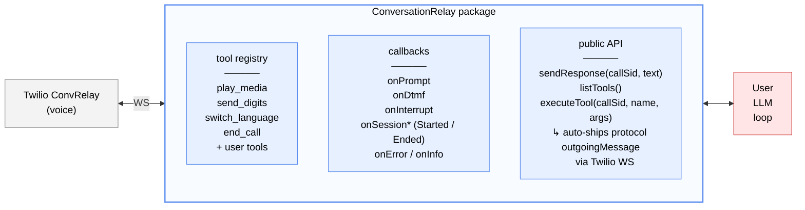

# @twilio/tac-conversationrelay

Pure ConversationRelay protocol utility for voice-only Twilio applications. Can be used standalone or as part of the TAC framework.

## Features

- WebSocket protocol handling for Twilio ConversationRelay
- Session lifecycle management (per CallSid)
- Event routing via callbacks
- TwiML generation for `<ConversationRelay>` noun
- Built-in protocol tool registry — LLM-discoverable, auto-ships outgoing messages
- Standalone server option (no Conversation Orchestrator required)

## Architecture



> **LLM SDK (OpenAI, Anthropic, Google, …) lives in USER code, never in CR.**
> Tool format conversion via `CRTool.toOpenAIFormat()` / `toAnthropicFormat()` at the call site.

## When to use this package

- **Voice-only app, no Conversation Orchestrator / no multi-channel** → use this package standalone. Session identity is the `CallSid`; you own LLM, history, and memory.
- **Voice + SMS / Chat, cross-channel identity, Twilio Memory** → use [`twilio-agent-connect`](../../README.md) (tac-core). This package is still used under the hood — tac-core's `VoiceChannel` embeds a `ConversationRelay` instance and integrates it with Conversation Orchestrator Conversations.

## Installation

```bash
npm install @twilio/tac-conversationrelay
```

## Setup

Both modes start the same way: construct `ConversationRelay`, register callbacks, pass the instance to `ConversationRelayServer`, start the server, point a Twilio voice number at `https://<host>:<port>/twiml`. What changes is whether you wire the server's optional callbacks to Conversation Orchestrator.

### Standalone mode (no Conversation Orchestrator)

Point your Twilio voice number at `/twiml` and drive your own LLM via `cr.onPrompt` / `cr.sendResponse`. No Conversation Orchestrator conversation is created; session identity is the `CallSid`.

Working example: **[`getting_started/examples/crelay/`](../../getting_started/examples/crelay/)** — OpenAI-backed voice agent, with interruption handling, tool dispatch, and env setup. Read its README to go end-to-end.

The minimum server wiring:

```typescript
import { ConversationRelay, ConversationRelayServer } from '@twilio/tac-conversationrelay';

const cr = new ConversationRelay();
cr.onPrompt(async (callSid, message) => {
  const reply = await yourLLM.chat(message);
  cr.sendResponse(callSid, reply);
});

await new ConversationRelayServer(cr, {
  authToken: process.env.TWILIO_AUTH_TOKEN!,
  port: 8001,
}).start();
```

### Integrated mode (with tac-core / Conversation Orchestrator)

`ConversationRelayServer` exposes two optional callbacks — `onIncomingCall` and `onConversationRelayCallback` — that let you splice Conversation Orchestrator into the TwiML / callback paths without this package importing from tac-core. Wire them to `VoiceChannel` methods that return plain data records:

- `onIncomingCall` is called on `POST /twiml`. Return a `Record<string, string>` of customParameters; CR splices them into the `<ConversationRelay>` TwiML element. `VoiceChannel.createConversationForCall` returns the four Conversation Orchestrator IDs (`conversation_id`, `profile_id`, `customer_participant_id`, `ai_agent_participant_id`), which arrive on the CR `setup` frame at WebSocket connect.
- `onConversationRelayCallback` is called when Twilio POSTs the URL declared as `<ConversationRelay action="…">` — at call-end (`CallStatus: 'completed'`) and on handoff requests. Return `{ status, content, contentType }`; `VoiceChannel.handleConversationRelayCallback` closes the Conversation Orchestrator conversation and returns handoff TwiML when applicable.

Omit both callbacks → standalone behaviour. Pass both → integrated. The package itself has **zero** dependency on `@twilio/tac-core`.

Working example: **[`getting_started/examples/conversation/`](../../getting_started/examples/conversation/)** — voice + SMS with Conversation Orchestrator, memory, and profile. Two Fastify servers in one process (TACServer :8000 for Conversation Orchestrator webhooks, ConversationRelayServer :8001 for voice).

## API reference

### ConversationRelay

Main class for ConversationRelay protocol handling.

**Callbacks:**
- `onSessionStarted(callback)` — call connects (setup message received)
- `onPrompt(callback)` — user transcript arrived (CR `prompt` message)
- `onInterrupt(callback)` — user interrupted agent speech
- `onDtmf(callback)` — DTMF input
- `onInfo(callback)` — INFO / diagnostic messages
- `onSessionEnded(callback)` — call ended (WebSocket closed)
- `onError(callback)` — error reported

**Response / action methods:**
- `sendResponse(callSid, message, last?)` — send text for TTS
- `sendPlay(callSid, source, options?)` — play media
- `sendDigits(callSid, digits)` — send DTMF
- `switchLanguage(callSid, options)` — switch TTS/transcription language
- `endCall(callSid, handoffData?)` — end the call

**Tool registry:**
- `listTools()` — all registered tools (built-ins + user-registered)
- `registerTool(tool)` — register an additional `CRTool`
- `unregisterTool(name)` — remove a tool
- `executeTool(callSid, name, args)` — run a tool; auto-ships any protocol `outgoingMessage`

**Server / lifecycle:**
- `generateTwiML(config, parameters, options)` — generate `<ConversationRelay>` TwiML
- `handleConnection(ws)` — accept a WebSocket connection
- `shutdown()` — close all connections

### ConversationRelayServer

Standalone Fastify server wrapping a `ConversationRelay` instance. Serves `/twiml`, `/ws`, and `/conversation-relay-callback` (plus a silent `/webhook` sink for Conversation Orchestrator misconfigurations).

**Constructor:**
```typescript
new ConversationRelayServer(conversationRelay: ConversationRelay, config: ConversationRelayServerConfig)
```

**Config options:**
- `host` — default `'0.0.0.0'`
- `port` — default `3000`
- `webhookPaths` — override any of `twiml`, `ws`, `callback`, `webhook`
- `conversationRelayConfig` — TwiML attributes (welcomeGreeting, ttsProvider, voice, transcriptionProvider, etc.)
- `development` — enable pino-pretty logging
- `authToken` — **required**. Twilio auth token; signature validation is always on
- `onIncomingCall?` — optional. `(input) => Promise<CustomParameters>`. Splices returned record into `<ConversationRelay>` as `<Parameter>` elements. Omit for standalone (CR emits `{ conversation_id: callSid }`)
- `onConversationRelayCallback?` — optional. `(payload) => Promise<{ status, content, contentType }>`. Called when Twilio POSTs the TwiML `action` URL (call-end and handoff). Omit for standalone (200 OK no-op)

## Voice-turn patterns

Two patterns come up in nearly every production voice agent. Neither is a CR protocol feature — CR emits no "silence" event and has no "listen-only" mode. Both are user-space patterns; this package ships a helper for the first.

### Silence detection — `SilenceDetector`

CR only emits `{type: 'prompt'}` when STT has a transcript. If the caller goes quiet, the WebSocket stays open and you'll never be told. `SilenceDetector` is a per-`CallSid` timer with progressive reminders:

```typescript
import { SilenceDetector } from '@twilio/tac-conversationrelay';

const detector = new SilenceDetector({
  thresholdSeconds: 15,
  reminders: ['Are you still there?', 'Hello?', 'Ending due to inactivity'],
  onSilence: (callSid, reminder, isTerminal) => {
    if (isTerminal) cr.executeTool(callSid, 'end_call', { reason: 'silence' });
    else cr.sendResponse(callSid, reminder);
  },
}, logger);

cr.onSessionStarted((callSid) => detector.reset(callSid));
cr.onPrompt((callSid) => detector.reset(callSid));
cr.onInterrupt((callSid) => detector.reset(callSid));
cr.onSessionEnded((callSid) => detector.stop(callSid));
```

Reset on every signal of life — including DTMF (common footgun: keypad input doesn't fire `onPrompt`). Call `stop(callSid)` on session end and `shutdown()` on process exit so timers don't leak.

### Listen mode (response suppression)

Sometimes the agent should listen but not speak — typically during sensitive-input flows (credit cards, one-time codes). There's no CR protocol for this: the way to stop the agent speaking is to skip `sendResponse`. Gate it on a per-call flag:

```typescript
const listenMode = new Map<string, boolean>();

cr.onPrompt(async (callSid, prompt) => {
  const reply = await yourLLM.run(prompt);
  if (!listenMode.get(callSid)) cr.sendResponse(callSid, reply);
  // else: swallow the reply, but still update your history
});
```

Keep running the LLM — just skip the wire write. If you skip the LLM too, your history loses context and the next turn becomes incoherent. Exit listen-mode on a known signal (N turns, specific utterance, or an LLM-triggered tool) so calls don't strand a silent agent.

## Authoring custom tools

```typescript
import { defineTool } from '@twilio/tac-conversationrelay';

const lookupOrder = defineTool(
  'lookup_order',
  'Fetch order status by order ID',
  {
    type: 'object',
    properties: { orderId: { type: 'string' } },
    required: ['orderId'],
  },
  async ({ orderId }: { orderId: string }) => {
    const order = await orderService.get(orderId);
    return { success: true, status: order.status };
  }
);

cr.registerTool(lookupOrder);
```

User tools without an `outgoingMessage` return their result for the LLM loop to consume. Built-in protocol tools (`play_media`, `send_digits`, `switch_language`, `end_call`) return `{outgoingMessage}` and `executeTool` auto-ships it via the WebSocket — your call site doesn't branch.

## License

MIT
